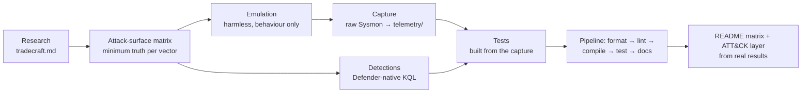

# MTDF Novel Threats

[](https://github.com/azdabat/MTDF-Novel-Threats/actions/workflows/threat-tests.yml)

**Novel tradecraft and zero-day detection-as-code.** Each threat is one folder: its tradecraft, an attack-surface matrix of every way it operates and the **minimum truth** each way cannot avoid leaving, behaviour-first detections for Microsoft Defender XDR and Sentinel, a harmless lab emulation, the raw telemetry it produced, and tests proving every detection fires on that telemetry.

Part of the **[Minimum Truth Detection Framework](https://github.com/azdabat/Minimum-Truth-Detection-Framework-ADX-Validated-Composite-Rules)**. Companion repository: **[MTDF-Detection-Tests](https://github.com/azdabat/MTDF-Detection-Tests)** proves the core composites against recorded Empire, Covenant and OTRF attacks; this one applies the same engine to threats too new for public datasets.

## Threats

<!-- THREATS:START -->
| Threat | Type | Status | Platforms | Matrix validated | Detections | Tests passing |
|---|---|---|---|---|---|---|
| [**Node.js Runtime Abuse**](threats/nodejs-runtime-abuse) | tradecraft | active | Windows, Linux | 0/15 | 9 | 0/0 |

*Not yet run.*
<!-- THREATS:END -->

## How a threat is built



| Stage | Tool | What it guarantees |
|---|---|---|
| **Format** | `tools/validate_threats.py` | Every threat has the same parts ([THREAT_FORMAT.md](THREAT_FORMAT.md)); every matrix row points at a real detection, boundary or plan |
| **Lint** | `tools/lint_kql.py` | The [MTDF bug classes](docs/bug-taxonomy.md): dead anchors, phantom columns, convergence by `count()`, unguarded rarity |
| **Compile** | `tools/semantic_check.py` | Every rule and test query type-checks with **Microsoft's own Kusto language service** against the Defender schema |
| **Test** | `tools/run_tests.py` | Each detection fires on the telemetry of the behaviour it claims to catch, on an Azure Data Explorer engine |
| **Docs** | `tools/build_threat_docs.py` | Each threat's README, coverage matrix and ATT&CK layer are generated from the last run, so they cannot overstate coverage |

## Why build it this way

- **Behaviour survives the next variant.** Detections anchor on what an attack must do after it lands, not on the hashes and domains of the last sample. See the [zero-day playbook](docs/zero-day-playbook.md).
- **Coverage is proven, not claimed.** A matrix row turns green only when a test against recorded telemetry passes.
- **The telemetry is an asset in its own right.** Every capture is raw, hashed, documented Sysmon: a dataset for [hunting](threats/nodejs-runtime-abuse/docs/hunting.md), forensic practice and regression-testing future rule changes.
- **Fires, survives, stays silent.** Every threat is tested three ways: the main attack path, its variants (renamed runtimes, alternate persistence, supply chain...), and a benign workflow every detection must stay silent on. The **Cousin Pack** of each threat holds the adjacent sensors that catch the variants.
- **Deployable as built.** Each detection says how it goes to production (index, triage or alert; Defender custom detection and Sentinel analytics rule) and carries the columns both platforms need. See the [deployment model](docs/deployment-model.md).
- **One engine, every threat.** The same lint, compile and test tooling as MTDF-Detection-Tests; a new threat is a folder, not a new project.

## Run it

Requirements: Python 3.10+, Docker (Kustainer), Node.js 18+ for the compile check.

```powershell
docker run -d -p 8080:8080 -e ACCEPT_EULA=Y mcr.microsoft.com/azuredataexplorer/kustainer-linux:latest
pip install -r requirements.txt
powershell -ExecutionPolicy Bypass -File lab.ps1            # format, lint, compile, test, docs
```

## Add a threat

```powershell
python tools\new_threat.py --slug <slug> --name "<name>" --type <tradecraft|malware|campaign|zero-day>
#  fill threat.yml + docs/, write emulation/, run it on the lab VM (lab/README.md)
python tools\add_detection.py --threat <slug> --rule <Rule.kql> --name <name> --tactic <tactic> ...
python tools\add_capture.py   --threat <slug> --capture <export.json> --id <capture_id> --title "..."
powershell -ExecutionPolicy Bypass -File lab.ps1
powershell -ExecutionPolicy Bypass -File publish.ps1 -Message "Add <slug>"
```

## Layout

```
MTDF-Novel-Threats/
├── threats/
│   ├── _template/              copied by new_threat.py
│   └── <slug>/                 one threat (THREAT_FORMAT.md)
├── lab/                        lab VM setup + log-everything Sysmon config
├── docs/                       deployment model, zero-day playbook, bug taxonomy, generated results + Navigator layers
├── tools/                      the pipeline (tools/README.md)
├── lab.ps1 · publish.ps1 · push_to_github.ps1
└── .github/workflows/threat-tests.yml
```

## Safety

Emulations reproduce behaviour, never exploits or malware. Telemetry contains attack command lines and may be flagged by endpoint protection; on a personal lab machine, exclude only the clone folder.

**Author:** Ala Dabat · Detection Engineering · Threat Hunting · Purple Team
