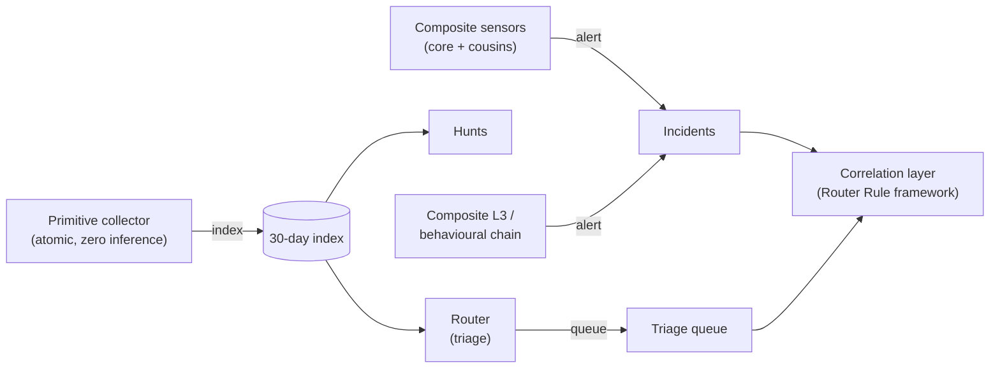

# Deployment model: atomic vs composite

MTDF separates *finding the truth* from *deciding to alert*. Each architecture has a different job, so each is deployed differently. Deploying everything as an alerting rule is the most common way a good detection set turns into an ignored queue.

## Which architecture goes where

| Architecture | Inference | Mode | Microsoft Defender XDR | Microsoft Sentinel | Alerts? |
|---|---|---|---|---|---|
| **Primitive collector** (atomic) | Zero: "node spawned a child" | Index | Saved hunting query or function; not a custom detection | **Summary rule** into a custom table, daily, with the retention you need (30 days here) | Never |
| **Router** | Low: which noise domain an event belongs to | Triage | Custom detection, every 1 hour, low/medium severity | Scheduled analytics rule, hourly, incidents grouped by host | To a queue, not to on-call |
| **Composite sensor** (core or cousin) | Minimum truth + reinforcement + noise control | Alert | Custom detection, every 1 hour (or continuous where the query allows) | Scheduled analytics rule, hourly; NRT for the highest-value ones | Yes |
| **Composite L3 / behavioural chain** | Multiple truths over a longer window | Alert | Custom detection, every 3–24 hours (cost) | Scheduled analytics rule with a lookback that covers the chain | Yes |
| **Hunt** | Exploratory | On demand | Advanced hunting | Hunting queries, notebooks | No |

**Atomic sensors index, routers triage, composites alert.** The collector's value is the history it keeps; a router's value is sending each event to the composite that understands its noise; a composite's value is a minimum truth that is worth an analyst's time.

## Rollout order for a new detection

1. **Lab-proven.** The detection passes its tests in this repository: it fires on the attack, survives the variants and stays silent on the benign workflow.
2. **Production build.** `python tools/prod_build.py` restores every `// LAB: production uses X` window. Nothing else changes.
3. **Hunt mode (1–2 weeks).** Run it as a hunting query over the estate. Every hit is either a true positive, a tuning item, or a new benign test case.
4. **Alert without incidents (1–2 weeks).** Deploy as a rule that records alerts but does not create incidents (Sentinel: incident creation off; Defender: low severity, no automated response). Measure volume per day and per device.
5. **Live.** Turn on incidents and set severity from the rule's own `Severity` column.
6. **Review on every change.** A rule change goes through the pipeline again; the tests catch a regression before production does.

## Tuning without breaking the minimum truth

- **Allowlists score down; they do not exclude.** An excluded path or parent is one an attacker can use. A score-down keeps the event visible to the other signals. (The Scheduled Task masquerade bug in MTDF-Detection-Tests was an allowlist that excluded.)
- **Tune in the variables at the top of the rule** (developer parents, build helpers, Electron app list), never in the minimum-truth line.
- **Every tuning change gets a benign test.** If a developer tool caused the noise, reproduce it in the threat's benign emulation so the fix is proven and stays fixed.

## Platform requirements

| Requirement | Defender XDR custom detection | Sentinel analytics rule |
|---|---|---|
| Output columns | `Timestamp`, `ReportId` and an entity column such as `DeviceId` | Entity mapping (Host, Account, Process, File, IP, URL) |
| Tables | `Device*` Advanced Hunting tables | Same tables via the Microsoft Defender XDR connector (they carry `TimeGenerated` as well as `Timestamp`) |
| Schedule | Continuous, or every 1, 3, 12 or 24 hours | 5 minutes to 14 days; NRT rules every minute |
| Severity | Set in the rule wizard | Static, or dynamic from a column (`Severity`) |

Every rule in this repository's threats carries `Timestamp`, `DeviceId` and `ReportId` in its output, so it can be deployed on either platform. The collector is the exception by design: it is an index, not a detection.

## Correlation

Individual sensors stay simple; the story is assembled above them. The [Router Rule / Attack Narrative Pipeline](https://github.com/azdabat/Router-Rule-Franework) groups sensor alerts by entity (device + account, source IP, hash), counts distinct stages, and scores the incident, so a loader alert, a persistence alert and a C2 alert on one device within hours become one incident instead of three.
