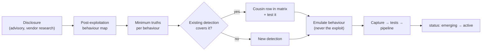

# Zero-day playbook

What happens in this repository from the moment a new vulnerability or campaign is disclosed to the moment its detections are proven. The premise is MTDF's: **an exploit is new, but what it has to do afterwards is not.** An attacker who gets code running must still start a process, write a file, load a module, touch a credential store or reach the network, and each of those has a minimum truth that was true before the CVE existed.



## Hour 0–4: scaffold and map

```powershell
python tools\new_threat.py --slug <cve-or-name> --name "<name>" --type zero-day --status emerging --cve CVE-YYYY-NNNNN
```

From the advisory and early research, fill `threat.yml`:

- `summary`: what is vulnerable, what an exploit gives the attacker (code execution as which user, in which process).
- `attack_surface`: one row per **post-exploitation** behaviour reported or implied: the process the exploit lands in spawning a shell, a web shell written to disk, a new service, credential access, outbound C2. Exploit-specific details (the malformed request, the gadget chain) are not rows: they change with every variant, and the behaviours after them do not.

## Hour 4–24: coverage from what already exists

For every row, ask whether an existing detection already anchors on that minimum truth. Most will: a web server process spawning `cmd.exe` is caught by a process-lineage rule whatever the bug. Record those as rows with `cousins:` links and **test them against the new behaviour** rather than assuming. The gaps that remain are the only new rules to write.

## Day 1–3: emulate, capture, prove

1. Write `emulation/` that reproduces the **post-exploitation behaviour** on the lab VM: the same parent process spawning the same children, the same file written to the same place, the same kind of outbound call. Use a stand-in for the vulnerable process where needed (for example, run the same binary name from the same path). Never reproduce the exploit itself.
2. Run it, then `tools\add_capture.py`. Every detection naming that capture gets a test.
3. `lab.ps1`. Diagnose every FAIL as a rule bug, a harness bug or a coverage boundary, and record boundaries in the matrix.
4. Publish. The README matrix now shows exactly which behaviours are proven.

## Week 1+: mature

- As public proof-of-concept code and real intrusion reports appear, add matrix rows for behaviours the first reports missed.
- If an OTRF or vendor dataset of the real exploitation appears, register it as a second capture: tests against real attack telemetry outrank tests against emulation.
- When every row is validated, a boundary, or planned with a named fix: `status: active`.

## Why this beats IOC-first response

| IOC-first | Behaviour-first (this playbook) |
|---|---|
| Waits for hashes, IPs, domains from someone else's incident | Starts from the advisory on hour 0 |
| Breaks on the next variant | Survives variants: the post-exploitation behaviour does not change |
| "We have a rule" | "We have a rule **and** a test proving it fires on the behaviour" |
| Coverage is a claim | Coverage is a generated matrix tied to test results |
